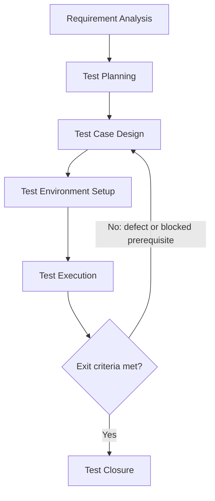

# Software Testing Life Cycle (STLC)

STLC is the sequence of QA activities used to plan, design, execute and close testing. The phases can overlap when findings change the test design.

## 1. Requirement Analysis

Identify testable behavior and ambiguity. For Ink2Digital, inspect the React pages, API routes, controllers, models and middleware. The source shows a password minimum of six characters, email validation in the browser input, duplicate email handling, authenticated document routes, and JPG/PNG/PDF upload limited to 10 MiB. It does not show a server-side email-format validator or a title-length constraint; tests should not assume either exists. Record unclear OCR accuracy expectations as an open requirement rather than inventing a pass threshold.

**Output:** source-based behavior inventory, risks, questions and traceable requirements.

## 2. Test Planning

Define goals, scope, approach, environments, roles, schedule, entry/exit criteria and risks. Ink2Digital planning prioritizes account access and file/document data because they gate the rest of the user workflow. Use a disposable database and synthetic files; do not use production accounts.

**Output:** `Test_Plan.md` and a prioritized execution order.

## 3. Test Case Design

Turn each behavior into repeatable steps with preconditions, inputs, expected results and evidence. For example, password equivalence classes include fewer than six characters (invalid) and six or more (valid); boundary tests use lengths 5, 6 and 7. Upload tests cover each allowed MIME type, a disallowed type, and sizes around 10,485,760 bytes. A decision table combines authorization, type and size. All cases begin as `Not Run` until executed.

**Output:** manual cases and black-box technique worksheets.

## 4. Test Environment Setup

Start MongoDB, the Express server and the Vite client, configure local environment variables, verify `/api/health`, and confirm OCR dependencies can initialize. Use a separate test database and test user. Record browser and OS versions. If any prerequisite fails, mark affected tests `Blocked` and capture the reason.

**Output:** recorded environment and readiness evidence.

## 5. Test Execution

Execute cases in planned order, using the exact data and steps. Compare observed behavior with expected behavior, save a named screenshot when it demonstrates the result, and record actual result, status, severity and defect ID. Examples include registering a unique account, uploading a valid PNG, digitizing it, saving corrected text, downloading a PDF, and confirming the downloaded file opens. Do not mark OCR as correct solely because a success message appeared; inspect the produced text.

**Output:** completed actual-result/status cells, evidence and defect reports.

## 6. Test Closure

Check case coverage, resolve status gaps, summarize passed/failed/blocked/not-run counts, calculate pass percentage from executed cases, and document defects, limitations and recommendations. Archive the workbook and evidence with the tested branch/build identifier. Closure does not mean every test passed; it means results and remaining risks are accurately reported.

**Output:** execution summary and closure record.
